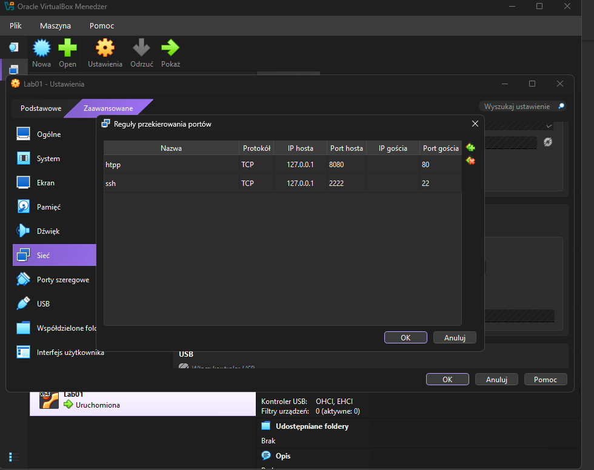
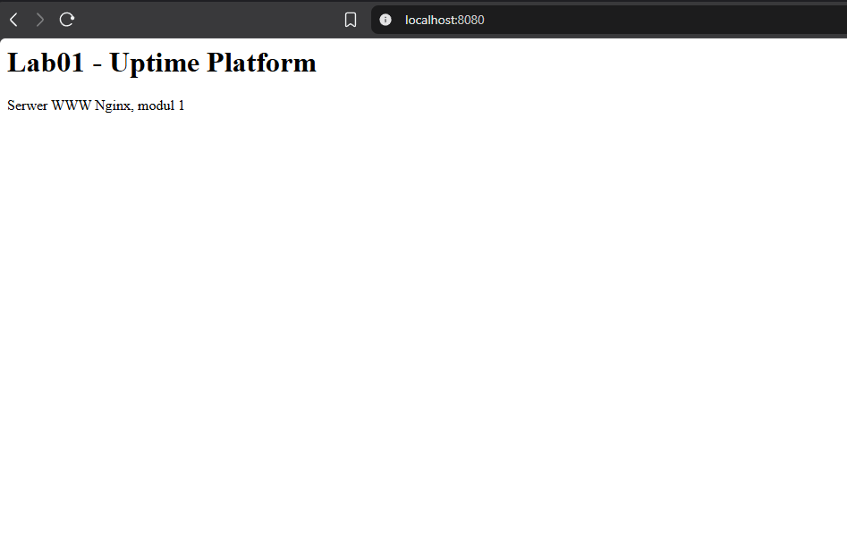

# Moduł 1: Serwer WWW

## Cel
Uruchomić serwer Nginx na lab01 i udostępnić własną stronę widoczną z komputera hosta.

## Środowisko
- Ubuntu Server LTS w VirtualBox (lab01)
- Sieć NAT z przekierowaniem portów: 2222 na hoście do 22 w lab01 (SSH), 8080 na hoście do 80 w lab01 (HTTP)



## Wykonane kroki
1. Instalacja serwera Nginx z repozytorium Ubuntu:
   `sudo apt update && sudo apt install nginx -y`
2. Sprawdzenie stanu usługi: `systemctl status nginx`
3. Sprawdzenie odpowiedzi serwera lokalnie: `curl -I http://localhost`
4. Dodanie w VirtualBox reguły przekierowania portu 8080 (host) na port 80 (lab01).
5. Sprawdzenie katalogu strony: `ls -l /var/www/html`
   Pliki należą do roota (uprawnienia 644), więc edycja wymaga `sudo`.
6. Utworzenie własnej strony: `sudo nano /var/www/html/index.html`
7. Podgląd logów na żywo podczas odświeżania strony: `sudo tail -f /var/log/nginx/access.log`
8. Analiza logów: liczba zapytań i błędów 404.

## Konfiguracja
| Plik / ustawienie | Rola |
| --- | --- |
| `/var/www/html/index.html` | własna strona startowa |
| VirtualBox: reguła 8080 na 80 | dostęp do strony z komputera hosta |

## Weryfikacja
Usługa działa i startuje automatycznie z systemem:
```
$ systemctl status nginx
     Loaded: loaded (/usr/lib/systemd/system/nginx.service; enabled; preset: enabled)
     Active: active (running)
```

Serwer zwraca stronę:
```
$ curl -I http://localhost
HTTP/1.1 200 OK
Server: nginx/1.28.3 (Ubuntu)
Content-Type: text/html
```

Strona widoczna w przeglądarce na komputerze hosta:



Każde zapytanie trafia do `/var/log/nginx/access.log`. Przykładowy wpis dla nieistniejącej ścieżki:
```
10.0.2.2 - - [21/Oct/2026:19:29:12 +0000] "GET /nieistnieje HTTP/1.1" 404 197 "-" "Mozilla/5.0 (Windows NT 10.0; Win64; x64) ..."
```

Analiza logu:
```
$ sudo wc -l /var/log/nginx/access.log
17 /var/log/nginx/access.log

$ sudo grep -c '" 404 ' /var/log/nginx/access.log
3

$ sudo awk '{print $9}' /var/log/nginx/access.log | sort | uniq -c
      5 200
      9 304
      3 404
```

## Problemy i rozwiązania
- **Problem:** strona nie otwierała się z Windowsa pod `http://localhost:8080`, choć na serwerze `curl` zwracał 200 OK.
  **Przyczyna:** brak reguły przekierowania portu 8080 na 80 w ustawieniach sieci NAT VirtualBox.
  **Rozwiązanie:** dodanie reguły w Ustawienia, Sieć, Zaawansowane, Przekierowanie portów.

## Czego się nauczyłem
- `systemctl start` uruchamia usługę od razu, a `systemctl enable` sprawia, że wstanie po restarcie systemu. W statusie widać to jako `enabled`.
- VirtualBox w trybie NAT ukrywa maszynę za sobą, więc żeby wejść na nią z Windowsa, trzeba przekierować port. Z tego samego powodu w logach Nginx widać adres 10.0.2.2 (brama VirtualBoxa), a nie adres mojego komputera.
- Pliki strony należą do roota i mają uprawnienia 644, więc mogę je czytać, ale do edycji potrzebuję `sudo`. Nginx działa jako użytkownik `www-data` i ma tylko prawo odczytu, co wystarcza do serwowania strony.
- Kody odpowiedzi: 200 to poprawna odpowiedź, 304 oznacza, że przeglądarka ma stronę w pamięci podręcznej i serwer nie wysyła jej ponownie, 404 to brak zasobu. Przeglądarka sama pyta o `/favicon.ico`, dlatego błędów 404 było więcej niż moich wejść na nieistniejącą stronę.
- Logi można szybko analizować potokami: `awk` wycina kolumnę z kodem odpowiedzi, a `sort` i `uniq -c` liczą wystąpienia.