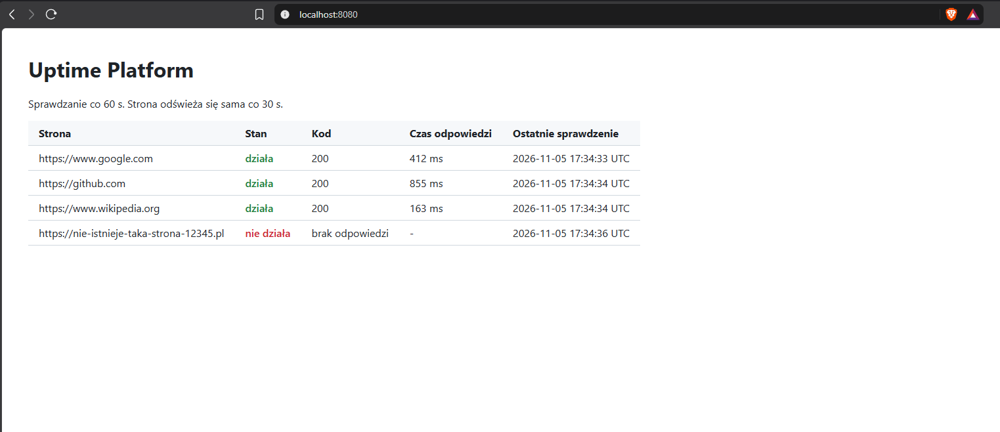

# Moduł 4: Aplikacja v1

## Cel
Napisać w Pythonie aplikację sprawdzającą dostępność stron i uruchomić ją na lab01 jako usługę systemd za Nginxem (reverse proxy).

## Architektura
```
Przeglądarka (host)  localhost:8080
VirtualBox NAT       8080 na 80
ufw                  port 80 otwarty
Nginx                0.0.0.0:80, reverse proxy
Aplikacja            127.0.0.1:8000 (Gunicorn + Flask, użytkownik uptime)
```
Aplikacja nasłuchuje tylko lokalnie, więc jest dostępna wyłącznie przez Nginx.

## Wykonane kroki
1. Instalacja narzędzi Pythona: `sudo apt update && sudo apt install python3-venv python3-pip -y`
   Wersje: Python 3.14.4, Git 2.53.0, pip 25.1.1.
2. Napisanie aplikacji w repozytorium: `app/app.py` i `app/requirements.txt`.
3. Pobranie kodu na serwer z GitHuba:
   `sudo git clone https://github.com/miloszekxk/uptime-platform.git /opt/uptime-platform`
4. Środowisko wirtualne i biblioteki:
   `sudo python3 -m venv /opt/uptime-platform/venv`
   `sudo /opt/uptime-platform/venv/bin/pip install -r /opt/uptime-platform/app/requirements.txt`
5. Ręczne uruchomienie testowe Gunicorna i sprawdzenie `/health` oraz `/api/status`.
6. Użytkownik systemowy dla aplikacji:
   `sudo useradd --system --no-create-home --shell /usr/sbin/nologin uptime`
7. Usługa systemd `uptime.service`, włączona przy starcie: `sudo systemctl enable --now uptime`
8. Konfiguracja Nginx jako reverse proxy, włączenie jej i wyłączenie domyślnej strony.
9. Testy: błąd 502 po zatrzymaniu aplikacji, automatyczny restart po awarii, restart serwera.

## Aplikacja
| Element | Rola |
| --- | --- |
| `check(url)` | wysyła zapytanie do strony, mierzy czas odpowiedzi, zwraca kod HTTP |
| `checker_loop()` | wątek w tle, co 60 s sprawdza wszystkie strony z listy `SITES` |
| `results` + `lock` | ostatnie wyniki w pamięci, chronione przed jednoczesnym zapisem i odczytem |
| `/` | tabela ze stanem stron, odświeżana co 30 s |
| `/api/status` | wyniki w formacie JSON |
| `/health` | odpowiedź `ok`, test, czy aplikacja żyje |

Biblioteki (`requirements.txt`): Flask 3.1 i Gunicorn 23. Pip doinstalował ich zależności (Werkzeug, Jinja2, click, itsdangerous, blinker, MarkupSafe, packaging).

Wyniki są na razie trzymane w pamięci i znikają po restarcie aplikacji. Baza danych dojdzie w Module 5.

## Konfiguracja

| Plik | Rola |
| --- | --- |
| `/opt/uptime-platform` | kod aplikacji, właściciel root (aplikacja może czytać, ale nie zmienić) |
| `/opt/uptime-platform/venv` | środowisko wirtualne z bibliotekami, ignorowane przez Git |
| `/etc/systemd/system/uptime.service` | usługa aplikacji ([kopia](../../config/lab01/systemd/uptime.service)) |
| `/etc/nginx/sites-available/uptime` | reverse proxy ([kopia](../../config/lab01/nginx/uptime)) |
| `/etc/nginx/sites-enabled/uptime` | dowiązanie symboliczne włączające konfigurację |

Usługa systemd:
```
[Unit]
Description=Uptime Platform - monitor dostepnosci stron
After=network-online.target
Wants=network-online.target

[Service]
User=uptime
Group=uptime
WorkingDirectory=/opt/uptime-platform/app
ExecStart=/opt/uptime-platform/venv/bin/gunicorn --bind 127.0.0.1:8000 --workers 1 --threads 4 --access-logfile - app:app
Restart=on-failure
RestartSec=5

NoNewPrivileges=true
ProtectSystem=strict
ProtectHome=true
PrivateTmp=true

[Install]
WantedBy=multi-user.target
```
Jeden worker, bo każdy worker uruchamiałby własny wątek sprawdzający i strony byłyby sprawdzane kilka razy. Cztery wątki obsługują zapytania przeglądarki równolegle. Opcje `NoNewPrivileges`, `ProtectSystem=strict`, `ProtectHome` i `PrivateTmp` zamykają aplikację w ograniczonym środowisku: system plików jest dla niej tylko do odczytu.

Reverse proxy w Nginx:
```
server {
    listen 80 default_server;
    listen [::]:80 default_server;
    server_name _;

    location / {
        proxy_pass http://127.0.0.1:8000;
        proxy_set_header Host $host;
        proxy_set_header X-Real-IP $remote_addr;
        proxy_set_header X-Forwarded-For $proxy_add_x_forwarded_for;
        proxy_set_header X-Forwarded-Proto $scheme;
        proxy_connect_timeout 5s;
        proxy_read_timeout 30s;
    }
}
```
```
sudo ln -s /etc/nginx/sites-available/uptime /etc/nginx/sites-enabled/uptime
sudo rm /etc/nginx/sites-enabled/default
sudo nginx -t
sudo systemctl reload nginx
```

## Weryfikacja

### Aplikacja w przeglądarce


### API
```
$ curl -s http://127.0.0.1:8000/api/status
[{"checked":"2026-11-05 17:17:50 UTC","ms":388,"status":200,"up":true,"url":"https://www.google.com"},
 {"checked":"2026-11-05 17:17:51 UTC","ms":653,"status":200,"up":true,"url":"https://github.com"},
 {"checked":"2026-11-05 17:17:51 UTC","ms":165,"status":200,"up":true,"url":"https://www.wikipedia.org"},
 {"checked":"2026-11-05 17:17:53 UTC","ms":null,"status":null,"up":false,"url":"https://nie-istnieje-taka-strona-12345.pl"}]
```

### Aplikacja działa jako użytkownik uptime
```
$ ps -o user,pid,cmd -C gunicorn
USER         PID CMD
uptime      2114 /opt/uptime-platform/venv/bin/python3 /opt/uptime-platform/venv/bin/gunicorn --bind 127.0.0.1:8000 ...
uptime      2121 /opt/uptime-platform/venv/bin/python3 /opt/uptime-platform/venv/bin/gunicorn --bind 127.0.0.1:8000 ...
```

### Test 1: zatrzymana aplikacja daje 502
```
$ sudo systemctl stop uptime
$ curl -I http://localhost
HTTP/1.1 502 Bad Gateway

$ sudo tail -n 1 /var/log/nginx/error.log
connect() failed (111: Connection refused) while connecting to upstream, client: 10.0.2.2, server: _, request: "GET / HTTP/1.1", upstream: "http://127.0.0.1:8000/"
```
502 oznacza, że Nginx działa, ale aplikacja za nim nie odpowiada. Problem jest więc w aplikacji, a nie w sieci ani w firewallu.

### Test 2: automatyczny restart po awarii
```
$ sudo kill -9 $(systemctl show -p MainPID --value uptime)
```
| Czas | Zdarzenie |
| --- | --- |
| 17:40:30 | proces 14051 zabity sygnałem KILL, `Failed with result 'signal'` |
| 17:40:35 | `Scheduled restart job, restart counter is at 1` (po 5 s, zgodnie z `RestartSec=5`) |
| 17:40:36 | nowy proces 14105 nasłuchuje na 127.0.0.1:8000 |

### Test 3: restart serwera
```
$ systemctl is-active uptime nginx
active
active

$ sudo ss -tlpn | grep -E ':80 |:8000 '
LISTEN 0  2048  127.0.0.1:8000  0.0.0.0:*  users:(("gunicorn",...))
LISTEN 0  511     0.0.0.0:80    0.0.0.0:*  users:(("nginx",...))
LISTEN 0  511        [::]:80       [::]:*  users:(("nginx",...))

$ curl -s http://localhost/health
ok
```
Nginx nasłuchuje na wszystkich interfejsach, aplikacja tylko na 127.0.0.1.

## Problemy i rozwiązania
- **Problem:** instalacja `python3-venv` przerwana błędem `404 Not Found` przy pakiecie `zlib1g-dev`.
  **Przyczyna:** nieaktualna lista pakietów wskazywała wersję, której nie ma już w repozytorium Ubuntu.
  **Rozwiązanie:** `sudo apt update`, potem ponowna instalacja.

- **Problem:** usługa `uptime` padała zaraz po starcie, w dzienniku `[Errno 98] Address already in use`.
  **Przyczyna:** ręcznie uruchomiony testowy Gunicorn nadal działał i zajmował port 8000. `curl /health` odpowiadał, ale była to ręczna kopia, a nie usługa. `systemctl status` sprawdzony 29 ms po starcie pokazywał jeszcze `active`.
  **Rozwiązanie:** `sudo ss -tlpn | grep :8000` pokazał proces trzymający port, `kill` zatrzymał ręczną kopię, `systemctl restart uptime`. Status sprawdzam teraz kilka sekund po starcie.

- **Problem:** `nginx -t` zgłaszał `Permission denied` dla `/run/nginx.pid`.
  **Przyczyna:** test uruchomiony bez `sudo`. Składnia była poprawna.
  **Rozwiązanie:** `sudo nginx -t`.

## Czego się nauczyłem
- Aplikacje webowe uruchamia się za reverse proxy: Nginx przyjmuje ruch z zewnątrz, a aplikacja nasłuchuje tylko lokalnie.
- Biblioteki aplikacji instaluje się w środowisku wirtualnym, żeby nie mieszać ich z Pythonem, z którego korzysta system.
- Aplikacja działa na osobnym koncie systemowym bez logowania, a kod należy do roota, więc aplikacja nie może go zmienić.
- systemd zapewnia start przy uruchomieniu serwera, restart po awarii i logi w `journalctl`. Opcje hardeningu dodatkowo ograniczają, co aplikacja może zrobić.
- Błąd 502 oznacza, że Nginx działa, a aplikacja za nim nie. Szczegóły są w `/var/log/nginx/error.log`.
- `Address already in use` oznacza zajęty port, a `ss -tlpn` pokazuje, który proces go trzyma.